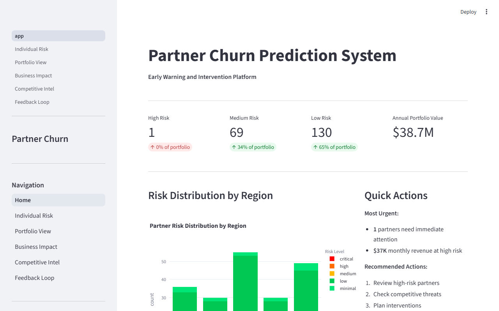
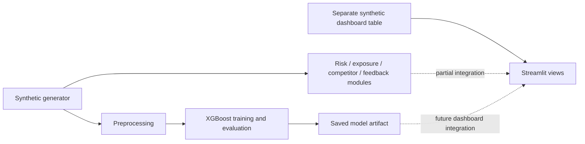

# Smart Partner Churn Prediction — Source Edition

An independent **Deriv AI Hackathon prototype** for relationship managers exploring partner churn: who appears at risk, what signals might explain it, and how a retention intervention could be prioritized.

The project combines a synthetic-data generator, an XGBoost training pipeline and a Streamlit dashboard with risk, portfolio, business-impact, competitor and intervention views. **Every dataset and business scenario is synthetic.** This is a collaborative hackathon project, not an official Deriv product or a deployed decision system.



*Real local Streamlit capture from this source edition, 17 October 2026. The dashboard uses a separate 200-row synthetic table and hand-coded risk rules. Displayed dollars, risk levels and interventions are illustrative, not measured commercial outcomes or trained-model predictions.*

## What is implemented

- Schema-driven generation of partner engagement, financial, relationship and competitive signals, with a simulated decline cascade and churn labels.
- Cleaning, feature engineering, encoding/scaling, stratified splitting and an XGBoost training/evaluation entry point.
- Library modules for SHAP explanations, CUSUM warnings, priority tiers, financial exposure, intervention ROI, competitor grouping and feedback analysis.
- A working Streamlit demonstration with a home view and five analysis pages.
- Optional Gemini recommendation code; service access and generated advice were not exercised in this verification.



## Working status and evidence

The local verification uses 160 newly generated synthetic rows, then checks preprocessing, risk-tier boundaries and financial-exposure arithmetic without retraining a model. Streamlit checks exercise actual application pages. Exact commands, results and limitations are in [verification notes](docs/VERIFICATION.md).

No new accuracy, ROC-AUC, SHAP quality, early-warning lead time or retention-impact result is claimed. Generated binary models and datasets are ignored in this source edition; the included archive is a historical project artifact. Full training and model/service integration need separate validation.

## Quick start

Python 3.10 was used locally. This repository keeps the application source at its root. From that root:

```powershell
python -m venv .venv
.\.venv\Scripts\Activate.ps1
pip install pandas numpy scikit-learn xgboost joblib python-dotenv streamlit plotly
python -m streamlit run dashboard/app.py --server.address 127.0.0.1
```

Open `http://localhost:8501`. The dashboard can run without a model or API key. Dependency versions are not locked; this was tested with existing local packages, not a clean installation.

For the fuller synthetic pipeline, `python run_demo.py --mode train` generates data, preprocesses and trains/evaluates a model; it overwrites generated artifacts. `--mode analyze` runs the orchestrator, which can use synthetic probabilities without a trained model. Optional SHAP and Gemini modules need additional dependencies. See the [full setup and code guide](docs/PROJECT_GUIDE.md).

From the repository root, repeat the bounded local check with:

```powershell
python docs/verify_local.py
```

## Limitations that matter

The dashboard is not wired to the trained XGBoost/SHAP pipeline: its explanatory bars, trends and intervention outcomes are demonstrations. Generator labels are rule-produced and can inherit strong cohort effects. Pre-split feature engineering uses dataset-wide statistics; validation on independent real partner history is absent.

Definitions differ across modules, including risk thresholds, region names and feature columns. The orchestrator has a model-probability shape mismatch and an ROI-key mismatch. CUSUM has toy demonstrations, not a validated warning lead time. Financial assumptions are fixed placeholders. The Gemini code and model identifiers require review before service use; no API success is claimed here. Keep credentials outside Git, and load pickle/joblib artifacts only from trusted sources.

## Provenance and deeper material

This flat source edition was committed by `takif0` and corresponds to the collaborative Team35 hackathon project. A local SHA-256 comparison found all 53 application source files identical to the companion repository at verification time. This is a packaging variant, not a separately claimed implementation. This overview describes the combined checked-in work without assigning unsupported individual ownership. The [preserved original guide](docs/PROJECT_GUIDE.md) contains module details, issue analysis and the source layout. The challenge brief and Team35 archive remain at the root. Generated data and model directories are ignored and are created locally; do not extract or restore old environment files from archives. There is no license file; reuse rights are not specified.
