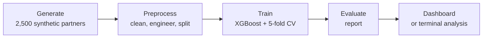

# Smart Partner Churn Prediction (Deriv AI Hackathon)

Source code for an **AI early-warning system for partner churn**, built for the Deriv AI Hackathon. It generates a synthetic portfolio of 2,500 partners, trains an **XGBoost** churn classifier, and adds modules for SHAP explanations, CUSUM drift detection, alerting, financial exposure and intervention ROI, competitor intelligence, Gemini-written retention advice and an intervention feedback loop. A **Streamlit** dashboard presents a five-page demo.

> **All data is synthetic.** It is generated by the code in `src/data_generation/`; no real partner or company data is used. This is an independent hackathon project, not an official Deriv product.

This repository holds the same source code as the `Deriv-AI-Hackathon-Smart-Partner-Churn-Prediction-master (2)/...-master` folder of the public Deriv-AI-Hackathon-Smart-Partner-Churn-Prediction repository (every shared file is identical), but in a **flat layout** and **without the generated data and model files**. For the full write-up (pipeline, modules, dashboard, limitations) see the README of that repository; the essentials are below.

---

## Quick start

```bash
python -m venv .venv
source .venv/bin/activate          # Windows: .venv\Scripts\activate
pip install pandas numpy scikit-learn xgboost joblib python-dotenv streamlit plotly
pip install shap google-generativeai     # optional: SHAP and Gemini modules

python run_demo.py --mode train          # generate data, preprocess, train, print evaluation
python run_demo.py --mode dashboard      # Streamlit dashboard on http://localhost:8501
python run_demo.py --mode analyze        # terminal analysis without the dashboard
python run_demo.py                       # everything, then the dashboard
```

`--mode generate` creates the dataset only, and `--mode full --skip-dashboard` runs the whole pipeline and ends with the terminal analysis.



---

## What is not in this repository

`.gitignore` excludes `data/raw/`, `data/processed/`, `models/`, `demo/`, `.env` and Python caches, so there is no `data/` or `models/` folder after cloning. They are created by `python run_demo.py --mode train`. The dashboard also works without them: on first launch it writes a 200-row demo table to `data/processed/partner_data.csv`.

`Team35_Churn Partner Prediction.zip` contains a copy of the project **including** the generated `data/` and `models/` folders, if you want the original files. The PDF is the hackathon challenge brief.

---

## Project structure

```
.
├── run_demo.py              # Entry point and the five run modes
├── config/                  # config.py (all parameters), feature_schema.py (72 features, 8 categories)
├── src/
│   ├── data_generation/     # Synthetic partners and decline cascade
│   ├── preprocessing/       # Cleaning, feature engineering, encoding, scaling, split
│   ├── modeling/            # XGBoost training and evaluation, CUSUM detector
│   ├── explainability/      # SHAP values and business-friendly driver categories
│   ├── alerting/            # Risk tiers, priority score, intervention window, cohort detection
│   ├── business_impact/     # Exposure, ROI, portfolio roll-ups, budget scenarios
│   ├── competitive_intel/   # Competitor extraction, regional threats, segment vulnerability
│   ├── recommendations/     # Gemini integration and prompt templates
│   ├── feedback_loop/       # Intervention tracking, effectiveness scoring, pattern mining
│   └── integration/         # DemoOrchestrator used by --mode analyze
├── dashboard/               # Streamlit app.py and pages 1 to 5
├── AI Partner Churn Prediction & Early Warning System (1).pdf   # Challenge brief
└── Team35_Churn Partner Prediction.zip
```

---

## Things to know

- **The dashboard is self-contained.** It reads its own demo table and does not load the trained model; its driver bars, trends and sample interventions are illustrative.
- **Most `src/` modules are libraries.** `run_demo.py` uses data generation, preprocessing, modeling and (in analyze mode) the orchestrator and business-impact modules. The others have self-test blocks, for example `python src/modeling/cusum_detector.py`.
- **No model metrics are stored.** Run `--mode train` to produce them; because labels are rule-generated, they only show that the pipeline works.
- **Gemini:** put `GEMINI_API_KEY=...` in a `.env` file. The configured model `gemini-1.5-flash` was shut down by Google on 29 September 2025 and the `google-generativeai` SDK is deprecated, so the Gemini modules currently fall back to canned or rule-based text until the model and SDK are updated.
- There is no `requirements.txt` or test suite.
